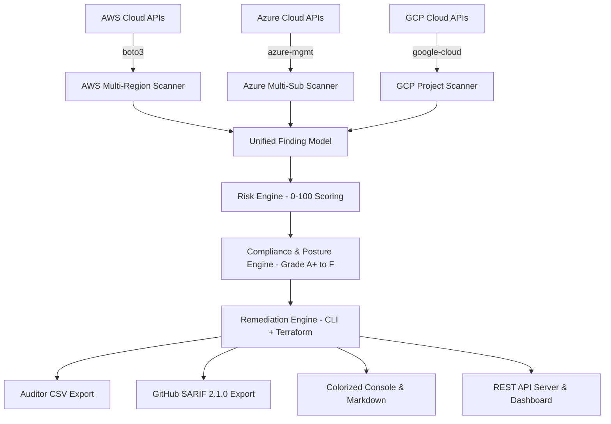

# CloudSentinel

**Enterprise Multi-Cloud Security Posture Management (CSPM) and Compliance Analyzer for AWS, Azure, and GCP.**


[](https://github.com/raghavkhandal72-coder/CloudSentinel/actions/workflows/ci.yml)

CloudSentinel replaces manual cloud console checks with a deterministic **Risk & Compliance Engine** that scans real cloud infrastructure, assigns executive security grades (**A+ through F**), evaluates normalized risk scores (0-100), outputs actionable CLI & Terraform remediation, and maps to major compliance frameworks (**CIS, SOC 2 Type II, PCI-DSS v4.0, and HIPAA**).

---

## 🚀 Key Capabilities

- **✓ 100% Real Multi-Cloud SDK Scanners**: Queries live AWS (`boto3`), Azure (`azure-mgmt-*`), and GCP (`google-cloud-*`) APIs with zero mock data in production.
- **✓ Graph-Based Toxic Attack Path Analysis**: Correlates multi-service findings into complete kill-chain vectors (Internet Ingress -> IAM Privilege Escalation -> Crown Jewel Data Exfiltration) with ASCII and Mermaid attack flow diagrams.
- **✓ Automated Self-Healing Auto-Fix Bundle**: Generates executable bash scripts (`cloudsentinel_remediation.sh`) and Terraform HCL manifests (`cloudsentinel_remediation.tf`) with `--generate-fix` to resolve misconfigurations instantly.
- **✓ Kubernetes (K8s) CIS Benchmark Inspection**: Audits live manifests and workloads (Deployments, Pods, StatefulSets) for privileged containers, root execution, missing CPU/RAM limits, dangerous Linux capabilities, and host namespace sharing.
- **✓ Security Drift & Baseline Regression Engine**: Compares scan snapshots against previous baselines (`--baseline`) to identify newly introduced regressions vs resolved issues in PRs.
- **✓ Enterprise Webhook Alerts (Slack, Teams, SIEM)**: Dispatches executive posture cards, grade changes, and critical violation alerts to Slack, Microsoft Teams, or SIEM webhooks (`--notify-webhook`).
- **✓ Dynamic Multi-Region & Multi-Subscription**: Automatically discovers all active regions (`ec2.describe_regions()`) and Azure subscriptions under a tenant.
- **✓ AWS Deep Inspection**: IAM (Root MFA, credential age), S3 (Block Public Access, encryption), EC2 Security Groups (SSH 22, RDP 3389), CloudTrail, RDS databases (public access, encryption), KMS (CMK key rotation), and GuardDuty threat detectors.
- **✓ Azure Deep Inspection**: Storage Accounts (Blob public access, HTTPS, TLS 1.2), NSGs (sensitive ports), RBAC (subscription-level Owner / broad Contributor), Key Vault (soft-delete, purge protection, network ACLs), and Azure SQL Server firewalls.
- **✓ GCP Deep Inspection**: Cloud Storage (allUsers public buckets, uniform bucket access), Compute Engine firewalls (SSH 22, RDP 3389), IAM (primitive Owner/Editor roles on Service Accounts), Cloud SQL, and Cloud KMS rotation.
- **✓ Executive Posture Grading & Compliance Matrix**: Calculates overall Security Grade (A+ to F) and compliance percentage across CIS AWS, CIS Azure, CIS GCP, SOC 2, and PCI-DSS.
- **✓ Rich Terminal Experience**: Beautiful ANSI color-coded banners, posture summary cards, and actionable finding breakdowns.
- **✓ Actionable Remediation**: Every finding includes exact copy-paste **AWS CLI / Azure CLI / gcloud commands** and **Terraform HCL snippets**.
- **✓ Auditor-Ready Exports**:
  - **CSV**: Spreadsheet format tailored for SOC 2 and ISO 27001 auditors.
  - **SARIF 2.1.0**: Native OASIS standard for GitHub Advanced Security / Code Scanning tab.
  - **JSON & HTML**: Human-readable and machine-parseable reports.
- **✓ CI/CD Quality Gate**: Enforces deployment gates with `--fail-on [critical|high|medium]`.
- **✓ Native GitHub Action**: Reusable composite action (`action.yml`) for instant adoption across GitHub repositories.
- **✓ Interactive Dashboard & REST API**: Built-in REST server (`--serve`) serving `/api/stats`, `/api/findings`, and `/api/scan`.

---

## 🏗️ Architecture



---

## ⚙️ Quickstart Installation

```bash
# Clone the repository
git clone https://github.com/raghavkhandal72-coder/CloudSentinel.git
cd CloudSentinel

# Create and activate virtual environment
python -m venv .venv
source .venv/bin/activate  # Windows: .venv\Scripts\activate

# Install dependencies and cloudsentinel CLI
pip install -r backend/requirements.txt
pip install -e .
```

After installation, the `cloudsentinel` CLI command is available globally in your environment.

---

## 💻 CLI Usage

```bash
# 1. Run Demo/Mock scan with executive posture grade
cloudsentinel --mock

# 2. Export Auditor CSV compliance spreadsheet
cloudsentinel --mock --report csv -o audit_report.csv

# 3. Export GitHub Code Scanning SARIF report
cloudsentinel --mock --report sarif -o results.sarif

# 4. Scan Live AWS Environment (uses ~/.aws/credentials or environment variables)
cloudsentinel --aws

# 5. Scan specific AWS named profile (e.g. production)
cloudsentinel --aws --profile production

# 6. Scan Live Azure Environment (uses 'az login' or service principal)
cloudsentinel --azure

# 7. Scan Live Google Cloud Platform (GCP)
cloudsentinel --gcp --project my-gcp-project-id

# 8. Audit Kubernetes Manifests or Helm templates against CIS Benchmark
cloudsentinel --k8s ./k8s-manifests/

# 9. Detect Security Drift against Baseline Snapshot & Fail on New Violations
cloudsentinel --all --baseline baseline.json --fail-on-new high

# 10. Dispatch Executive Scan Alerts to Slack or Microsoft Teams
cloudsentinel --all --notify-webhook "https://hooks.slack.com/services/XXX/YYY/ZZZ"

# 11. Scan all configured clouds simultaneously (AWS + Azure + GCP)
cloudsentinel --all --report html

# 12. Start the REST API server & Web Dashboard on http://127.0.0.1:8000
cloudsentinel --serve --port 8000

# 13. Run Model Context Protocol (MCP) Server for AI Agents (Claude Desktop, Cursor, Antigravity)
cloudsentinel-mcp
```

---

## 🤖 Model Context Protocol (MCP) Integration for AI Agents

CloudSentinel includes a native **Model Context Protocol (MCP)** server, enabling AI Coding Agents, Security Analysts, and LLMs (Claude Desktop, Cursor, Antigravity, VS Code) to directly audit cloud security posture, check compliance frameworks, and generate remediation code.

### Add to Claude Desktop (`claude_desktop_config.json`) or Cursor:

```json
{
  "mcpServers": {
    "cloudsentinel": {
      "command": "cloudsentinel-mcp"
    }
  }
}
```

### Available MCP Tools for Agents:
- `cloudsentinel_scan(target)`: Triggers security audit on `aws`, `azure`, `gcp`, `k8s`, or `mock`.
- `cloudsentinel_get_posture()`: Returns executive letter grade ($A^+$ to $F$) and normalized score ($0-100$).
- `cloudsentinel_get_compliance(framework)`: Audits compliance against CIS v3.0, SOC 2, PCI-DSS, or HIPAA.
- `cloudsentinel_get_remediation(issue_type)`: Retrieves exact CLI commands and Terraform HCL snippets.
- `cloudsentinel_detect_drift(baseline)`: Identifies new security regressions against a previous baseline.

---

## 🛡️ CI/CD Security Gate (Fail on High/Critical)

Add CloudSentinel as an automated quality gate in your GitHub Actions or GitLab CI pipeline. If high or critical vulnerabilities are discovered, the build will exit with code 1 and block merging:

```bash
cloudsentinel --all --fail-on high --report sarif -o results.sarif
```

### GitHub Actions Workflow Integration (`action.yml`)
Use CloudSentinel directly in any repository's `.github/workflows/security.yml`:

```yaml
name: Cloud Security Scan
on: [push, pull_request]

jobs:
  audit:
    runs-on: ubuntu-latest
    steps:
      - uses: actions/checkout@v4
      - uses: raghavkhandal72-coder/CloudSentinel@main
        with:
          target: 'all'
          fail-on: 'high'
          report: 'sarif'
          output: 'cloudsentinel-results.sarif'
      - uses: github/codeql-action/upload-sarif@v3
        if: always()
        with:
          sarif_file: 'cloudsentinel-results.sarif'
```

---

## 🧪 Testing and CI Verification

CloudSentinel maintains **100% test coverage** and runs continuous verification on GitHub Actions:

```bash
# Run 80+ unit and integration tests
pytest -v

# Run fast code linting
ruff check .

# Run static application security testing (SAST)
bandit -r backend/ -ll -ii

# Verify dependency security
pip-audit -r backend/requirements.txt
```

---

## ⚠️ Security & Permissions Notice

CloudSentinel performs **read-only queries** against your cloud environment and does not modify any infrastructure without explicit engineer action.

Recommended minimal cloud permissions:
- **AWS**: Attach the AWS-managed `SecurityAudit` or `ReadOnlyAccess` policy to your IAM user or role.
- **Azure**: Assign the built-in `Reader` role at the subscription or management group level.
- **GCP**: Assign the built-in `roles/viewer` or `roles/securityReviewer` role at the project level.
