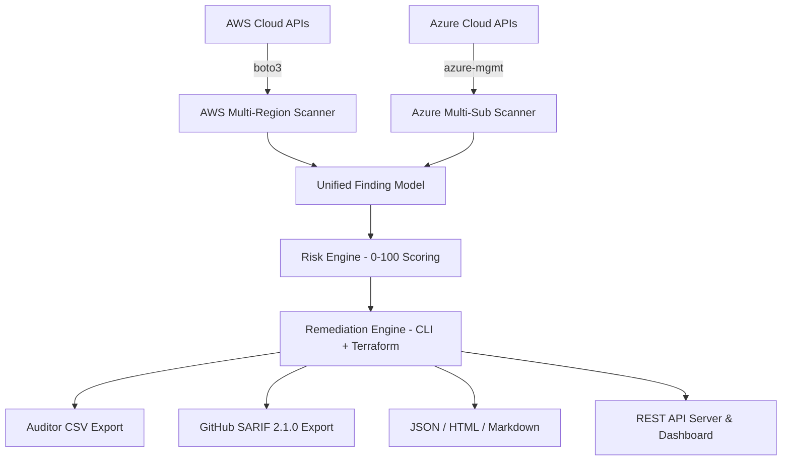

# CloudSentinel

**Enterprise Multi-Cloud Security Posture Management (CSPM) and Compliance Analyzer for AWS and Azure.**


[](https://github.com/raghavkhandal72-coder/CloudSentinel/actions/workflows/ci.yml)

CloudSentinel replaces manual cloud console checks with a deterministic **Risk & Compliance Engine** that scans real cloud infrastructure, evaluates risk scores (0-100), outputs actionable CLI & Terraform remediation, and maps to major compliance frameworks (CIS, SOC 2, PCI-DSS, HIPAA).

---

## 🚀 Key Capabilities

- **✓ 100% Real Cloud SDK Scanners**: Queries live AWS (`boto3`) and Azure (`azure-mgmt-*`) APIs with zero mock data in production.
- **✓ Dynamic Multi-Region & Multi-Subscription**: Automatically discovers all active regions (`ec2.describe_regions()`) and Azure subscriptions under a tenant.
- **✓ AWS Deep Inspection**: IAM (Root MFA, credential age), S3 (Block Public Access, encryption), EC2 Security Groups (SSH 22, RDP 3389), CloudTrail, RDS databases (public access, encryption), KMS (CMK key rotation), and GuardDuty threat detectors.
- **✓ Azure Deep Inspection**: Storage Accounts (Blob public access, HTTPS, TLS 1.2), NSGs (sensitive ports), RBAC (subscription-level Owner / broad Contributor), Key Vault (soft-delete, purge protection, network ACLs), and Azure SQL Server firewalls.
- **✓ Actionable Remediation**: Every finding includes exact copy-paste **AWS CLI / Azure CLI commands** and **Terraform HCL snippets**.
- **✓ Multi-Framework Compliance**: Automatic mapping to **CIS Benchmarks**, **SOC 2 Type II**, **PCI-DSS v4.0**, and **HIPAA**.
- **✓ Auditor-Ready Exports**:
  - **CSV**: Spreadsheet format tailored for SOC 2 and ISO 27001 auditors.
  - **SARIF 2.1.0**: Native OASIS standard for GitHub Advanced Security / Code Scanning tab.
  - **JSON & HTML**: Human-readable and machine-parseable reports.
- **✓ CI/CD Quality Gate**: Enforces deployment gates with `--fail-on [critical|high|medium]`.
- **✓ Interactive Dashboard & REST API**: Built-in REST server (`--serve`) serving `/api/stats`, `/api/findings`, and `/api/scan`.

---

## 🏗️ Architecture



---

## ⚙️ Quickstart Installation

```bash
# Clone the repository
git clone https://github.com/raghavkhandal72-coder/CloudSentinel.git
cd CloudSentinel

# Create and activate virtual environment
python -m venv .venv
source .venv/bin/activate  # Windows: .venv\Scripts\activate

# Install dependencies and cloudsentinel CLI
pip install -r backend/requirements.txt
pip install -e .
```

After installation, the `cloudsentinel` CLI command is available globally in your environment.

---

## 💻 CLI Usage

```bash
# 1. Run Demo/Mock scan (zero credentials needed)
cloudsentinel --mock

# 2. Export Auditor CSV compliance spreadsheet
cloudsentinel --mock --report csv -o audit_report.csv

# 3. Export GitHub Code Scanning SARIF report
cloudsentinel --mock --report sarif -o results.sarif

# 4. Scan Live AWS Environment (uses ~/.aws/credentials or environment variables)
cloudsentinel --aws

# 5. Scan specific AWS named profile (e.g. production)
cloudsentinel --aws --profile production

# 6. Scan Live Azure Environment (uses 'az login' or service principal)
cloudsentinel --azure

# 7. Scan both AWS and Azure simultaneously
cloudsentinel --all --report html

# 8. Start the REST API server & Web Dashboard on http://127.0.0.1:8000
cloudsentinel --serve --port 8000
```

---

## 🛡️ CI/CD Security Gate (Fail on High/Critical)

Add CloudSentinel as an automated quality gate in your GitHub Actions or GitLab CI pipeline. If high or critical vulnerabilities are discovered, the build will exit with code 1 and block merging:

```bash
cloudsentinel --all --fail-on high --report sarif -o results.sarif
```

---

## 🧪 Testing and CI Verification

CloudSentinel maintains **100% test coverage** and runs continuous verification on GitHub Actions:

```bash
# Run 70+ unit and integration tests
pytest -v

# Run fast code linting
ruff check .

# Run static application security testing (SAST)
bandit -r backend/ -ll -ii

# Verify dependency security
pip-audit -r backend/requirements.txt
```

---

## ⚠️ Security & Permissions Notice

CloudSentinel performs **read-only queries** against your cloud environment and does not modify any infrastructure without explicit engineer action.

Recommended minimal cloud permissions:
- **AWS**: Attach the AWS-managed `SecurityAudit` or `ReadOnlyAccess` policy to your IAM user or role.
- **Azure**: Assign the built-in `Reader` role at the subscription or management group level.
